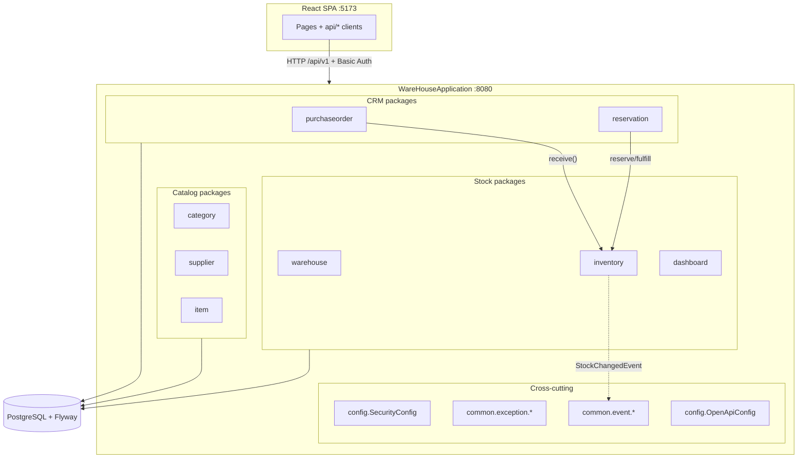
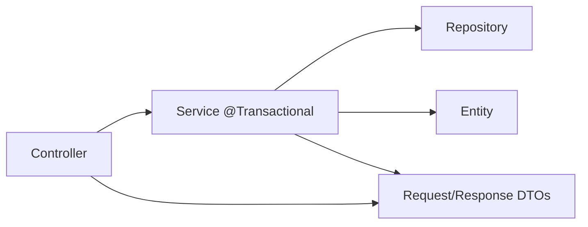
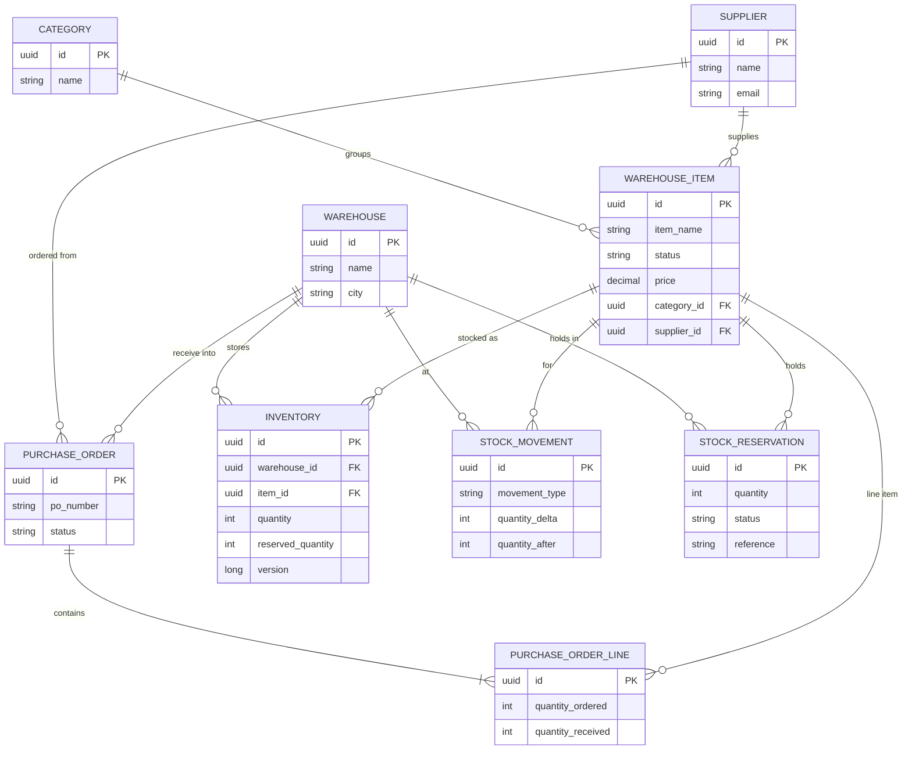
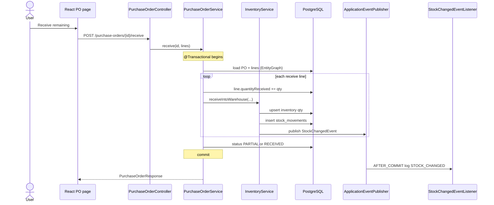
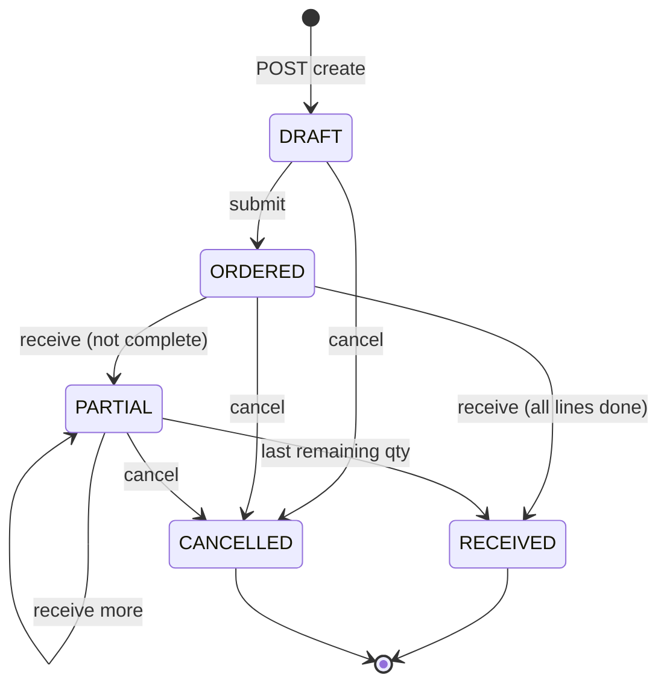
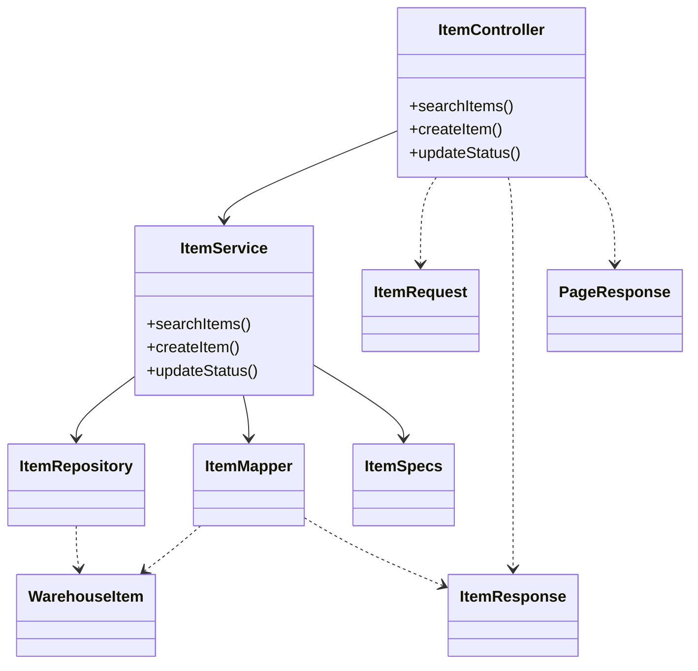

# UML for this warehouse CRM (study)

## Read me first (simple)

UML is just **pictures of the system** so your brain does not drown in files.

You do **not** draw every Java class. You draw **three** pictures:

| # | Picture | Question it answers | When to use |
|---|---------|---------------------|-------------|
| 1 | Packages / boxes | What are the big parts? | First slide / intro |
| 2 | ER / domain | What things exist + how they link? | Data model talk |
| 3 | Sequence (+ state) | What happens step-by-step for one action? | “Explain transfer/PO receive” |

**How to view Mermaid diagrams below**

1. Open https://mermaid.live  
2. Paste a ```mermaid block  
3. Or use GitHub / IDE Mermaid preview  

**How this maps to Finance** (same shapes, new names): see [TRANSFER_TO_OTHER_DOMAINS.md](TRANSFER_TO_OTHER_DOMAINS.md).

**Learning order**

1. Look at diagram 2 (ER) while clicking Items vs Inventory in the UI  
2. Look at diagram 3 while clicking **Receive** on a Purchase Order  
3. Only then memorize diagram 1 (packages)

---

## 1. Component / package diagram (modular monolith)

One deployable Spring Boot app; packages = future microservice candidates.



**Layer pattern inside each feature package (repeat this, don’t draw 50 classes):**



---

## 2. Domain model (ER / class relationships)

This is the diagram interviewers want for “show me the domain”.  
Cardinality matches JPA/`@ManyToOne` / `@OneToMany`.



### How to read it in words

- **Category / Supplier / Warehouse** = master / lookup data  
- **WarehouseItem** = catalog SKU (no quantity)  
- **Inventory** = qty of one SKU in one warehouse (`UQ(warehouse, item)`)  
- **StockMovement** = audit of qty changes  
- **PurchaseOrder + Line** = inbound aggregate  
- **StockReservation** = soft hold on available qty  

**Important:** do **not** put every Controller/Service/DTO on this diagram — that is noise. Domain ER + one package layer diagram is enough.

---

## 3. Sequence — receive purchase order (best CRM story)



### Why this sequence matters

- Shows **Controller thin → Service owns rules**  
- Shows **nested `@Transactional` (REQUIRED)** joining PO + inventory  
- Shows **domain event after commit** (not before)

---

## 4. State diagram — purchase order lifecycle



---

## 5. Optional: class sketch for one feature (Items)

Only draw **one** vertical slice in detail when teaching layering:



Repeat the same shape for `category`, `inventory`, etc. — that is the study pattern.

---

## What to draw in a whiteboard interview (2 minutes)

1. Boxes: **React → API → packages → Postgres**  
2. ER core: **Item – Inventory – Warehouse** (+ Category/Supplier)  
3. One sequence: **PO receive** or **transfer**  
4. Say: “Modular monolith; packages can become services later”

---

## File map (open IDE beside the diagram)

| UML box | First open this | Then this |
|---------|-----------------|-----------|
| Catalog item | `item/package-info.java` | `ItemController.java` |
| Category | `category/package-info.java` | `Category.java` + `V2__…sql` |
| Inventory | `inventory/package-info.java` | `InventoryService.java` |
| PO receive sequence | `purchaseorder/PurchaseOrderService.java` | method `receive` |
| Movements | `inventory/StockMovement.java` | `V7__create_stock_movements.sql` |
| Security box | `config/SecurityConfig.java` | — |
| Events box | `common/event/StockChangedEvent.java` | Listener next to it |

| UML box | Packages |
|---------|----------|
| Catalog | `item/`, `category/`, `supplier/` |
| Stock | `warehouse/`, `inventory/`, `dashboard/` |
| CRM | `purchaseorder/`, `reservation/` |
| Cross-cutting | `config/`, `common/` |

Related: [START_HERE.md](START_HERE.md), [PROJECT_MAP.md](../PROJECT_MAP.md), [BACKEND_STUDY.md](BACKEND_STUDY.md), [TRANSFER_TO_OTHER_DOMAINS.md](TRANSFER_TO_OTHER_DOMAINS.md).
